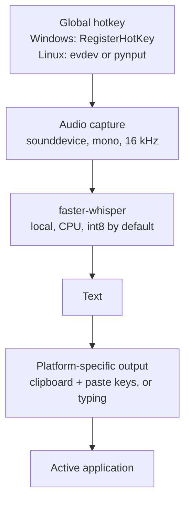

# WhisperFlow

Offline system-wide speech-to-text for Windows and Linux using [faster-whisper](https://github.com/SYSTRAN/faster-whisper).

Press a hotkey, speak, press it again, and the recognized text is inserted **at the current cursor position** in whatever application is focused: Word, a browser, a chat window, a code editor.

Runs locally on the CPU. No cloud, no account, no cost. The only network access is the one-time model download on first start.

## Why I built it

I wanted a dictation tool that works like Wispr Flow, but runs entirely on my own machine, costs nothing and sends nothing to the internet. It is the tool I use most in my daily work.

## What it does

- **Global hotkey** (default `Ctrl + Alt + W`), configurable, in two modes: `toggle` (press / press) or `push_to_talk` (hold).
- **Local transcription** with faster-whisper; model, language, compute type, beam size, VAD filter and an initial prompt for domain terms are configurable.
- **Paste-back into the active application**, either via the clipboard + `Ctrl+V` (default, reliable for umlauts) or by typing the text. On Windows the previous clipboard content is restored afterwards.
- **Audio feedback**: short beeps for start, stop, done and error.
- **Background mode / autostart** on Windows (Startup folder shortcut, no console window) and Linux (XDG autostart).
- **Robustness details**: single-instance lock, automatic audio re-initialization after standby or headset changes, fallback to the device's native sample rate with resampling to 16 kHz, rotating log file.

## Architecture



Hotkey threads only enqueue `down` / `up` events. Recording control and transcription run in their own worker threads, so a slow microphone, a blocked console or a transcription error cannot stall hotkey detection.

### Project structure

```
WhisperFlow/
├── config.json              Settings (shared by both platforms)
├── requirements.txt         Python dependencies (with platform markers)
├── whisperflow/
│   ├── app.py               Recording, transcription, control flow
│   ├── hotkey.py            Hotkey parser and key-state matching
│   ├── platform_windows.py  Windows: RegisterHotKey, text insertion, beeps
│   └── platform_linux.py    Linux: evdev/pynput, xdotool/wtype, beeps
├── windows/                 install.bat, start.bat, autostart scripts
└── linux/                   install.sh, start.sh, autostart scripts
```

## Technical details

**Windows hotkeys.** Earlier versions used a low-level keyboard hook. Windows silently removes such hooks when they respond too slowly, which happened under CPU load during transcription. Missed key-release events (lock screen `Win+L`, `Ctrl+Alt+Del`, UAC, standby) also left modifiers "stuck", and clicking into the console (QuickEdit) froze the program. Since version 2, WhisperFlow uses `RegisterHotKey`, polls the real key state for key release, and disables QuickEdit. If a hotkey cannot be registered, it falls back to a keyboard hook via the `keyboard` library.

**Linux: hotkeys and text insertion.** X11 and Wayland are supported (GNOME, KDE, wlroots compositors such as Sway/Hyprland).

| | X11 | Wayland |
|---|---|---|
| Hotkey | `pynput` (no extra permissions) | `evdev` via `/dev/input` (group `input`) |
| Insert text | `xdotool` (otherwise `pynput`) | `wtype` → `/dev/uinput` → `ydotool` |
| Clipboard | `xclip` / `xsel` | `wl-clipboard` |

If no key-sending tool is available, the text is left in the clipboard and can be pasted manually with `Ctrl+V`.

**Why not `Win + W`?** On Windows 11, `Win + W` is reserved for the Widgets panel. Windows does not let applications register it, so WhisperFlow would fall back to the less robust keyboard hook and the Widgets panel would still open. That is why the default is `Ctrl + Alt + W`. If you really want `Win + W`, turn off Widgets first (*Settings → Personalization → Taskbar → Widgets*) and set `"hotkey": "windows+w"`.

## Installation / Running locally

Requires Python 3 (with `venv`) and a working default microphone. On first start the selected model is downloaded (about 500 MB for `small`); after that everything runs offline.

### Windows

1. Run **`windows\install.bat`**: creates the `venv` and installs `requirements.txt`.
2. Run **`windows\start.bat`**: starts WhisperFlow in a console window.

Optional autostart (hidden, beeps only):
- Enable: `windows\install-autostart.bat`
- Disable: `windows\install-autostart-entfernen.bat`

> If you set up autostart with an older version, run `windows\install-autostart.bat` once more so the shortcut points to the new folder.

### Linux

```bash
chmod +x linux/*.sh
./linux/install.sh
./linux/start.sh
```

`install.sh`:
- installs (after confirmation, via `sudo`) Python venv, compiler, PortAudio and `xclip`/`xdotool` (X11) or `wl-clipboard`/`wtype` (Wayland), for apt, dnf, pacman and zypper,
- creates the Python environment `venv/`,
- on **Wayland**, offers to add your user to the `input` group (needed for global hotkeys) and to enable `/dev/uinput`. Log out and back in once afterwards.

Optional autostart:
- Enable: `./linux/install-autostart.sh` (XDG autostart, runs in the background after login)
- Disable: `./linux/uninstall-autostart.sh`

### Usage

1. Start WhisperFlow (the console / terminal shows the status).
2. Place the cursor where the text should go.
3. Press **`Ctrl + Alt + W`**: high beep, **start speaking**.
4. Press **`Ctrl + Alt + W`** again: low beep, wait briefly, the text appears.

Quit with `Ctrl + C` in the console or by closing the window. Only one instance can run at a time. The log is written to `whisperflow.log` in the project folder, which is useful when WhisperFlow runs in the background.

## Configuration: `config.json`

Edit the file and restart WhisperFlow:

| Setting | Meaning | Values |
|---|---|---|
| `hotkey` | Key combination | e.g. `ctrl+alt+w`, `f9`, `ctrl+shift+space` |
| `mode` | Recording mode | `toggle` (press/press) or `push_to_talk` (hold) |
| `model` | Accuracy vs. speed | `tiny`, `base`, `small`, `medium`, `large-v3` |
| `language` | Language | `de`, `en`, … or `auto` |
| `compute_type` | Numeric precision | `int8` (fast), `int8_float32`, `float32` |
| `paste_method` | How text is inserted | `clipboard` (Ctrl+V) or `type` |
| `paste_keys` | Keys used to paste | `ctrl+v` (default), `ctrl+shift+v` for Linux terminals |
| `add_trailing_space` | Append a space | `true` / `false` |
| `sounds` | Beeps | `true` / `false` |
| `initial_prompt` | Context / domain terms | e.g. `"Fachbegriffe: Kubernetes, Anthropic"` |
| `linux_backend` | Hotkey detection on Linux | `auto`, `evdev`, `pynput` |

`config.json` also contains `device` (default `cpu`), `beam_size` (default `1`) and `vad_filter` (default `true`), which are passed to faster-whisper.

`push_to_talk` works with single keys (`f9`) and with combinations (`ctrl+alt+w`); recording stops as soon as the main key is released.

### Which model?

Without an NVIDIA GPU everything runs on the CPU. Rough guidance (estimates, not benchmarks):
- **`small`** (default): good trade-off, roughly 1–3 s per sentence, good German.
- **`base`**: faster, slightly less accurate.
- **`medium`**: more accurate, but noticeably slower on the CPU.

## Troubleshooting

- **"Hotkey is already in use":** another program uses the combination; choose a different hotkey.
- **"WhisperFlow is already running":** an instance is already running (e.g. via autostart).
- **Text appears in the log but is not inserted:** some programs run as administrator (e.g. Task Manager), and a normal process cannot send keys to them. Start WhisperFlow as administrator too, or set `paste_method` to `type`.
- **"Microphone could not be opened":** check that a default input device is set. After standby or a headset change, WhisperFlow re-initializes audio automatically.
- **Hotkey stops responding after a while:** see *Windows hotkeys* above; check `whisperflow.log`.
- **Linux: "no readable keyboard under /dev/input":** `sudo usermod -aG input $USER` and log in again, or on X11 set `"linux_backend": "pynput"`.
- **Linux terminal does not paste:** set `"paste_keys": "ctrl+shift+v"`.
- **Very slow:** choose a smaller model (`base` or `tiny`).
- **Wrong language detected:** set `language` explicitly (e.g. `de`) instead of `auto`.
- **Broken umlauts:** keep `paste_method` at `clipboard` (default).

## Limitations

- Windows and Linux only; other operating systems are not supported.
- Audio shorter than 0.3 s is ignored.
- On Windows, text cannot be sent to applications running with higher privileges unless WhisperFlow runs elevated as well.
- On Linux with `evdev`, letters refer to the **physical key in the US layout**; on a German layout `y` and `z` are swapped.
- Global hotkeys on Wayland require membership in the `input` group.
- The user interface messages and log output are in German.
